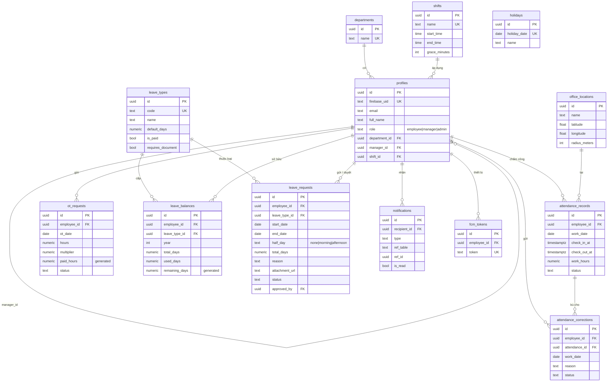

# Thiết kế cơ sở dữ liệu (ERD) — TimeKeeper

Phần báo cáo do **TV4** phụ trách. Nguồn: `supabase/schema.sql` (13 bảng, Supabase PostgreSQL).

## 1. Sơ đồ quan hệ



## 2. Nhóm bảng theo module

| Module | Bảng | Phụ trách |
|---|---|---|
| Người dùng | `departments`, `shifts`, `profiles` | TV1 |
| Chấm công | `office_locations`, `attendance_records`, `attendance_corrections` | TV2 |
| Tăng ca | `ot_requests` | TV3 |
| Nghỉ phép | `leave_types`, `leave_balances`, `leave_requests`, `holidays` | TV4 |
| Thông báo | `notifications`, `fcm_tokens` | TV5 |

## 3. Quyết định thiết kế chính

- **Khóa chính `uuid`** (`gen_random_uuid()`) cho mọi bảng, dễ sinh ở client và không lộ số thứ tự.
- **`profiles` là trung tâm**: Firebase Auth giữ danh tính, `profiles.firebase_uid` (unique) nối sang Supabase. Mọi bảng nghiệp vụ tham chiếu `profiles.id` qua `employee_id`, không dùng `firebase_uid` làm khóa ngoại.
- **Trạng thái đơn thống nhất** `pending | approved | rejected | cancelled` cho `ot_requests`, `leave_requests`, `attendance_corrections`, nên TV5 gộp được 3 loại đơn vào một hộp duyệt; cột `approved_by`, `approved_at`, `reject_reason` giống nhau.
- **Cột generated** (`leave_balances.remaining_days`, `ot_requests.paid_hours`) để DB tự tính, tránh lệch số liệu giữa các màn hình.
- **Ràng buộc unique**: `attendance_records(employee_id, work_date)` (1 bản ghi / ngày), `leave_balances(employee_id, leave_type_id, year)` (1 số dư / loại / năm), `holidays.holiday_date`.
- **`notifications.ref_table + ref_id`**: liên kết đa hình tới đơn liên quan, bấm thông báo mở đúng đơn.
- **Index** trên `employee_id`, `status` và khoảng ngày (`leave_requests(start_date, end_date)`) cho các truy vấn lọc thường dùng.
- **RLS** bật cho mọi bảng; giai đoạn dev dùng policy `dev_all_<bảng>` (cách A) cho anon/authenticated.

## 4. Module Nghỉ phép (TV4)

```
leave_types (1) ──< leave_balances >── (1) profiles
leave_types (1) ──< leave_requests >── (1) profiles
holidays: bảng độc lập, dùng để trừ ngày lễ khi tính số ngày nghỉ
Storage bucket "leave_documents": file đính kèm, URL lưu ở leave_requests.attachment_url
```

Luồng dữ liệu:

1. Mở form xin nghỉ → `LeaveRequestRepository.getBalances()`; nếu nhân viên chưa có dòng `leave_balances` của năm thì tự tạo theo `leave_types.default_days`.
2. Tính `total_days` bằng `LeaveCalculator.countDays()`: bỏ thứ 7, chủ nhật, ngày trong `holidays`; nửa ngày = 0.5.
3. Kiểm tra số dư: `remaining_days` trừ tổng `total_days` của các đơn `pending` cùng loại (đơn chờ duyệt "giữ chỗ").
4. Có file → upload lên bucket `leave_documents` theo đường dẫn `<employee_id>/<timestamp>_<tên file>` rồi ghi `attachment_url`; ghi đơn lỗi thì xóa file vừa upload.
5. TV5 duyệt đơn → cập nhật `status`, `approved_by`, `approved_at` và cộng `leave_balances.used_days`.
6. Lịch nghỉ team: `leave_requests` join `profiles!employee_id!inner` lọc theo `department_id`, trạng thái `approved` + `pending`, giao với tháng đang xem.
